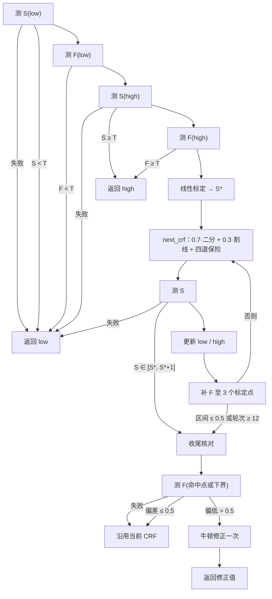

# AGENTS.md

本文件面向在本仓库中工作的 AI 模型 / 编码 Agent：说明仓库结构、核心算法与不变量、测试约定，方便直接阅读和修改代码。面向最终用户的操作说明见 [README.md](README.md)，二者分工：**用户怎么用看 README，代码怎么改看这里。**

## 仓库结构

Cargo workspace，三个成员：

| crate | 类型 | 职责 |
|---|---|---|
| `crates/media-box-core` | 库 | 媒体扫描、输出路径、VMAF 目标搜索、SVT-AV1 编码、终端 UI 等全部逻辑；不依赖 clap，通过入参结构与二进制解耦 |
| `crates/media-box` | 二进制 | `media-box video-compress` 的 CLI 解析与启动 |
| `crates/image-convert` | 二进制 | `image-convert` 的 CLI 与纯 Rust 图片转换引擎 |

依赖方向：两个二进制都依赖 `media-box-core`；`image-convert` 复用 core 的 `collect_files` / `ScannedFile` 与 `collision_free`。

## media-box-core 模块地图

| 模块 | 职责 |
|---|---|
| `byte_size` | `ByteSize` 与人类可读体积格式化 |
| `compressor` | 压缩流水线编排：阶段推进、逐文件调度、取消处理 |
| `crf_probe` | CRF 搜索的测量实现（ffmpeg + libvmaf 采样）与搜索日志适配 |
| `crf_search` | CRF 搜索状态机：标定、插值、收敛（纯逻辑，无外部依赖） |
| `encode_job` | 正式编码的 ffmpeg 命令组装、进度解析与执行 |
| `encoder` | 分辨率/帧率缩减设置与 AV1 编码参数，拼 `-vf` |
| `ffmpeg_args` | ffmpeg 命令构建器：按调用顺序追加公共选项，纯组装不启动进程 |
| `film_grain` | film-grain 强度计算：调用 YDIF 探测并汇总代表值 |
| `format` | 时长与 UTC 时间戳格式化 |
| `interrupter` | Ctrl+C 处理与取消状态 |
| `media_scan` | 按扩展名递归收集文件（跳过符号链接、去重） |
| `output_path` | 输出基名/最终路径、同批冲突去重 |
| `probe` | 用 ffprobe 读元数据（分辨率、帧率、时长、体积） |
| `process` | 子进程输出按行按流读取，带取消轮询 |
| `progress` | 解析 ffmpeg `-progress pipe:1` 输出，算百分比与 ETA |
| `report` | 阶段定义、成功/失败/警告报告模型 |
| `resolution` | 分辨率枚举与解析 |
| `scene_detect` | `ffmpeg scdet` 场景切点检测与日志解析 |
| `scene_sampler` | 由切点规划场景样本（长度、边缘排除、回退） |
| `stats` | 中位数等统计工具 |
| `ui` | 终端仪表盘渲染 |
| `value` | 数值 newtype（CRF、preset、VMAF、帧率、film-grain）及解析 |
| `vmaf` | libvmaf 滤镜图构造（同规格 / 全规格两口径） |
| `ydif_probe` | `signalstats` YDIF 探测 |
| `ydif_stats` | YDIF 序列统计、置信度与强度映射 |

## 压缩流水线与阶段

阶段顺序定义在 `report::Stage`，枚举顺序即执行顺序：

```
元数据 → 场景采样 → 颗粒强度分析 → CRF 搜索 → 正式编码
```

终端界面按阶段展示：`✓` 已完成、转圈表示当前阶段、`·` 未开始，阶段内附加说明（如「CRF 32.00 · 样本 2/3 · VMAF 测量」）；只有正式编码阶段显示百分比、已用时间与剩余时间。

## CRF 搜索（核心算法）

代码：`crates/media-box-core/src/crf_search.rs`。本节解释「为什么这样搜」，以及每个常数背后的取舍。

### 1. 问题与两个口径

记 `S(c)` 为同规格 VMAF、`F(c)` 为全规格 VMAF，两者都随 CRF 单调递减。要求 `c*` 使 `F(c*) = T`（`T` 为用户目标）。没有解析解，只能实测。

为什么迭代用 `S`、收尾才用 `F`：

| 口径 | 参考帧 | 失真帧 | 计算量 | 抖动 |
|---|---|---|---|---|
| `S` 同规格 | 缩到输出分辨率 | 原样 | 小 | 小 |
| `F` 全规格 | 原样 | 上采样回源分辨率 | 大（按源分辨率算） | 大 |

每轮都测 `F`，成本翻倍且更噪；只信 `S` 又会系统性偏（`F ≈ S - δ`）。折中方案：**用 `S` 驱动搜索，用标定点把目标搬到 `S` 轴，最后用 `F` 核对一次**。

```text
VMAF
 92 ┤ L●●
 88 ┤ ┈┈┈●●★●●┈┈┈┈┈┈┈┈┈┈┈┈┈┈┈┈┈┈┈┈┈┈┈
 84 ┤         ●●●●●
 80 ┤              ●●●●●
 76 ┤                   ●●●●●
 72 ┤                        ●●●●●
 68 ┤                             ●●H
```

横轴 CRF 20 → 50，纵轴每行 4 分；`L` = 下界 20，`H` = 上界 50，`★` = 目标 88，`┈` = 目标容差带 [88, 89]，`●` = `S(c)`。

### 2. 单调性 → 二分

`S` 单调递减，区间不变式：`S(low) ≥ S*` 且 `S(high) < S*`（`S*` 是标定后的同规格目标）。每轮取中点即可减半，`log2(30 / 0.5) ≈ 6` 轮就够。但二分完全不利用曲线形状，起点远时收敛慢。

### 3. 割线法：用最近两点估斜率

把最近两次测量 `(c₁, S₁)`、`(c₂, S₂)` 连成直线外推到目标：

```text
k        = (S₂ - S₁) / (c₂ - c₁)      ← 单位「分 / CRF」，负数
c_interp = c₂ + (S* - S₂) / k
```

例：`(20, 92)`、`(50, 68)`，`S* = 89` → `k = -0.8` → `c_interp = 23.75`，一步就跳到答案附近。

单独用很危险：平台区（`|k| < 0.1`）分母趋零；断崖区（`|k| > 10`）一点噪声就差几档；任一点测错下一步出区间。因此只信任 `k ∈ (-10, -0.1)`（`trusted_slope`）。

### 4. 混合 + 四道保险

```text
c_bisect = (low + high) / 2
c_mixed  = 0.7 · c_bisect + 0.3 · c_interp     ← 保守为主，插值为辅
c_next   = clamp(c_mixed, low, high)            ← 保险 1：不出区间
         = clamp(·, c_prev ± max_step)          ← 保险 2：单轮步长
         → 吸附 0.25 网格                        ← 保险 3：与 CRF 类型一致
         → 与 c_prev 相同或越界则退回 c_bisect    ← 保险 4：保证有进展

max_step = clamp((high - low) / 2, 0.5, 8.0)
```

权重偏二分，是因为样本 VMAF 有 ±0.5~1 的噪声，割线对噪声敏感而二分永远安全。步长上限防「斜率估偏 → 跳到边缘 → 下一轮跳回来」的震荡。

### 5. 标定：把目标从 `F` 轴搬到 `S` 轴

只用 `S = T` 去搜会停在画质偏高的一侧：`F = S - δ`（`δ > 0`），所以 `S = T` 时 `F = T - δ < T`，还得继续压 CRF。标定就是估出这条偏移，解 `S*` 使 `F(S*) = T`。

**线性（两个端点）**

```text
a  = (F₂ - F₁) / (S₂ - S₁)
b  = F₁ - a·S₁
S* = (T - b) / a          ← 再夹到 [min(S₁,S₂), max(S₁,S₂)]
```

例：端点 `(92, 91)`、`(68, 67)` → `a = 1`、`b = -1` → `T = 88` 时 `S* = 89`。含义：同规格测到 89 分时，全规格大约就是 88 分。夹取是因为两点之外属于外推。

**二次（三个点，凑满后尝试一次）**

`F(S) = a·S² + b·S + c`，解 `a·S² + b·S + (c - T) = 0`：

```text
Δ = b² - 4a(c - T)
S = (-b ± √Δ) / (2a)      ← 取落在 [S₁, S₃] 内的那个根
```

用二次是因为低码率一侧降规格损失占比变化更快，`F - S` 不是常数。

标定点来自全规格测量：两个端点各一个，第 3 个在搜索轮次里补测。补测条件是「不足 3 个点」，所以某个端点的测量失败时会自动在后续轮次补齐；正常路径（两端点都成功）只多花一次全规格测量。凑满 3 点后只尝试一次，校验不过就永久退回线性，不会每轮重复测。

三道安全校验，任何一条不满足就退回线性（或直接用 `T`）：

| 校验 | 条件 | 不通过的含义 |
|---|---|---|
| 曲率 | `\|a\| ≤ 0.05` | 三点几乎共线，或全是噪声 |
| 单调 | 顶点落在区间外 | 区间内先降后升，反解有两个根 |
| 有解 | `Δ ≥ 0` | 目标值没被这条抛物线取到 |

### 6. 收敛与终止

| 条件 | 判据 | 说明 |
|---|---|---|
| 命中窗口 | `S ∈ [S*, S*+1]` | 窗口跟着标定后的目标走，只向上放宽 |
| 区间收敛 | `high - low ≤ 0.5` | 网格 0.25，再分没有意义 |
| 轮次上限 | `round ≥ 12` | 病态曲线兜底（正常 5~7 轮） |

命中窗口时**返回命中点**（`hit_crf`）；只有区间收敛/轮次上限才退回下界 `low`。窗口围绕 `S*` 而不是 `T`：只围 `T` 时，命中点按标定其实还不达标，收尾会被迫做一次大修正。代价是命中点没有下界不变式背书，达标完全由下一节的收尾核对兜底。

### 7. 收尾：全规格核对 + 一次牛顿修正

```text
delta = F(c_hit) - T

|delta| ≤ 0.5          → 直接采用 c_hit
delta < -0.5（偏低）    → 局部线性化 F(c+Δ) ≈ F(c) + k·Δ，k = dF/dc < 0
                          Δ  = -delta / k
                          c' = c + 0.8·Δ      ← 0.8 阻尼防过冲
```

符号要小心：`delta < 0`、`k < 0` ⇒ `Δ < 0` ⇒ `c' < c`（降 CRF、提画质）。写成 `c + delta·(dc/dF)` 会得到 `c' > c`，越修越差——这是修掉的一个符号错误。

数值例：`c = 20`、全规格 86、目标 88 → `delta = -2`、`dc/dF = -1.25` → `Δ = -2.5` → `c' = 20 - 2.0 = 18`，夹到 `[low-1, high]` 得 19；`F(19) = 86.8`，误差从 2.0 收到 1.2。

### 8. 一个完整的例子

合成曲线 `S(c) = 100 - 0.8(c-10)`、`F = S - 1`，目标 88：

| 轮次 | 动作 | CRF | S | 区间 | 说明 |
|---|---|---|---|---|---|
| 1 | 测下界 | 20.0 | 92.0 | [20, 50] | 达标；全规格 91 → 标定点 (92, 91) |
| 2 | 测上界 | 50.0 | 68.0 | [20, 50] | 未达标；标定点 (68, 67) |
| — | 线性标定 | — | — | — | `F = S - 1` → `S* = 89` |
| 3 | 候选 | 42.0 | 74.4 | [20, 42] | interp=23.75、mid=35、mixed=31.6，步长上限 8 → 42 |
| 4 | 候选 | 34.0 | 80.8 | [20, 34] | mixed=28.8，步长 8 → 34 |
| 5 | 候选 | 27.0 | 86.4 | [20, 27] | mixed=26.0，步长 7 → 27 |
| 6 | 候选 | 23.5 | 89.2 | [20, 27] | 落入 [89, 90]，命中 |
| 收尾 | 全规格 | 23.5 | — | — | `F = 88.2`，偏差 +0.2，直接采用 |

共 10 次测量：2 端点 × 2 口径 + 4 轮 `S` + 1 次补测 `F` + 1 次收尾 `F`。第 3~4 轮仍受步长上限 8 约束（插值早就指向 23.75），第 5 轮起上限降到 7，不再是瓶颈。

### 9. 流程



### 10. 常数与成本

| 常数 | 值 | 作用 | 调大的后果 |
|---|---|---|---|
| `MAX_SEARCH_ROUNDS` | 12 | 轮次上限 | 病态曲线更慢 |
| `TARGET_SCORE_TOLERANCE` | 1.0 | 命中窗口宽度 | 更早收敛，体积更大 |
| `FINAL_CHECK_TOLERANCE` | 0.5 | 收尾容差 | 更容易跳过修正 |
| `MIN_SEARCH_SPAN` | 0.5 | 区间收敛阈值 | 更多轮 |
| 混合权重 | 0.7 / 0.3 | 二分 : 割线 | 更激进（快但抖） |
| 单轮步长 | 0.5 ~ 8.0 | 防震荡 | 更激进 |
| 阻尼 | 0.8 | 牛顿修正 | 更容易过冲 |

单次搜索成本 ≈ `(2 + 2 + R + 2) × 样本数` 次编码 + 同数量 VMAF 测量，`R` 为搜索轮次。3 样本、6 轮 ≈ 36 次编码——这是「CRF 搜索比正式编码还贵」的原因。

### 11. 已知取舍

- 命中窗口返回命中点，体积更小；代价是「达标」只由收尾核对兜底，命中点本身没有下界不变式背书。
- 二次标定凑满 3 点后只尝试一次，校验不过就退回线性；退化路径（端点测量失败）会自动补测，最坏多花 2 次全规格测量。
- 步长上限 8 在起点远离答案时仍可能多走 1~2 轮（第 8 节的第 3~4 轮），换来的是抗噪。

### 搜索初始区间

按输出分辨率给出：4K 24–55、2K 22–52、1080p 20–50、720p 18–45、更低 16–40（见 `suggest_crf_range`）。

## 场景采样

- `ffmpeg -vf scdet` 全片扫切点；相邻切点间隔 < 1s 视为同一簇，只保留分数最高者。
- 按切点切分场景，丢弃时长 < 2s、与片头/片尾 5% 重叠的场景。
- 取最长的至多 3 个场景，各取中点，单个样本最多 20s。
- 全片 ≤ 100s 时只取全片中点样本（最多 20s）。
- 检测失败、无切点或无可用场景：退化为 1/4、1/2、3/4 位置采样，各最多 20s。

实现：`scene_detect.rs`（解析 scdet 日志）、`scene_sampler.rs`（规划与回退）。

## film-grain

- 每个样本取约 2s，用 `signalstats` 输出 YDIF，计算均值与变异系数 CV。
- 置信阈值动态计算：`clamp(0.5 + 0.2 × min(ydif / 15, 1), 0.5, 0.7)`。
- 高置信样本数 ≥ `max(1, ceil(K/2))` 时取这些样本的中位数，否则取全部有效样本的中位数。
- YDIF 代表值映射：< 1 → 0，1–3 → 4，3–8 → 8，8–15 → 12，> 15 → 15。
- 分析失败或样本全失效：`film-grain=8`。

实现：`ydif_probe.rs`（探测）、`ydif_stats.rs`（统计与映射）、`film_grain.rs`（汇总）。

## VMAF 两口径

`vmaf.rs` 按 `VmafMeasureMode` 构造 libvmaf 滤镜图。同规格的参考支路直接复用 `settings.video_filter()`，与样本编码走完全相同的滤镜链，只衡量编码损失；全规格在源分辨率上衡量编码 + 降规格的总损失。**不要**用 `output_resolution()` 硬拼 `scale=w/h` 到参考支路：等比缩小（`force_original_aspect_ratio=decrease`）后实际尺寸小于目标边界，不放大时实际尺寸等于源，硬拼会让两路尺寸不一致并使 VMAF 测量失败。`output_resolution()` 只在缩放真正发生时取目标，否则返回源。分辨率不变时同一次测量即可，`SampleMeasurer::full_spec_is_distinct` 返回 `false` 会跳过端点全规格、标定补测与收尾复核（测量次数约减 40%）。

模型按实际输出分辨率选择：4K 用 `vmaf_v1.0.16_1d5h_2160`，其余用 `vmaf_v1.0.16_3d0h`。

VMAF 测量意图是**颗粒合成后的最终观感**：`crf_probe.rs` 的 `build_vmaf_command` 两路都不加 `-export_side_data +film_grain`，让失真帧与源片按各自码流正常合成颗粒。该选项是 per-input 的，单侧设置会造成两路颗粒口径不一致。

ffmpeg 命令统一由 `ffmpeg_args::FfmpegCommand` 组装：方法调用顺序即参数顺序（`-ss` 在 `-i` 前后语义不同，构建器刻意不重排），覆盖 VMAF 测量、scdet、YDIF 探测与正式编码四路。ffprobe 是不同工具、仅一处调用，不纳入该构建器。所有命令组装都是纯函数，用 `get_args()` 完整序列断言锁定参数顺序，不启动 ffmpeg。`process::display_command` 对含空白的参数加引号，保证展示的命令可直接重放。

## 编码参数

`libsvtav1`，`-preset <p>`，`-crf <crf>`，`-flags -cgop`，`yuv420p10le`，`-svtav1-params tune=5:keyint=-1:qp-scale-compress-strength=1:film-grain=<fg>`；音频 `-c:a copy`；缩放与限帧通过 `scale=...:flags=lanczos` 和 `fps=` 滤镜完成。滤镜顺序：先 `fps` 再 `scale`，链更短、缩放输入更少。

## 进程与进度

- `process.rs` 以 50ms 轮询子进程输出，按流分发行；超长行截断、stderr 保留最近 200 行，取消请求能在轮询间隔内被响应。
- `progress.rs` 解析 `-progress pipe:1` 的 `out_time_ms` / `total_size` / `progress`，算出百分比与 ETA；只在变化达到 `MIN_DELTA_PERCENT` 时发射，避免刷屏。
- 编码失败或取消时删除半成品输出（`encode_job.rs`）。

## 取消

`interrupter.rs` 用 `Canceller` 区分「用户取消」与普通失败。第一次 `Ctrl+C` 置位取消标记，各阶段检测到后返回 `Cancelled`；第二次 `Ctrl+C` 直接 `process::exit(1)`。锁中毒时仍读取内部状态，保证信号线程不 panic。

## image-convert 架构

- `format.rs`：格式表（只含常用格式 png/jpg/jpeg/gif/webp/bmp），定义 `TargetFormat`、扩展名解析与 `--list-formats` 能力矩阵。
- `codecs.rs`：输入解码接入层，直接用 image 内置解码器，无扩展格式桥接。
- `convert.rs`：批量转换引擎。收集 → 为整批预留输出路径 → 工作池并发执行 → 按源路径排序返回结果；支持 `--dry-run` / `--meta list`。
- `metadata.rs`：通过 image 解码器读 EXIF / ICC 原始字节，支持 `keep` / `strip` / `list`。
- `output_path.rs`：按 `-o` 镜像目录结构推导输出路径。
- `report.rs`：逐文件结果与汇总打印。

编码策略（`convert.rs` 的 `encode_to_buffer`）：JPEG 用可配置质量；PNG 在 `--optimize` 时启用最高无损压缩，`keep` 透传 EXIF/ICC；其余格式走 image 通用写出。写盘采用同目录临时文件 + 重命名，避免失败留下半截输出。

## 测试约定

### 运行

```bash
cargo test                      # 全部
cargo test --test crf_search    # 只跑搜索策略的行为测试
cargo test --test performance   # 只跑性能预算测试
cargo test --lib                # 只跑模块内单元测试
cargo bench -p media-box-core   # 进程内基准（Criterion，harness = false）
cargo clippy --all-targets
cargo fmt --check
```

测试**不需要 ffmpeg**：搜索逻辑用合成曲线驱动，解析逻辑用固定文本驱动。

### 性能测量

- **基准与预算测试分离**：`benches/media_box_core.rs` 用 Criterion 测墙钟时间（解析、节流、采样规划、统计、滤镜拼接、目录扫描、CRF 搜索状态机）；`tests/performance.rs` 与 `tests/crf_search.rs` 用确定性断言测次数/规模上界（进度发射、样本数、搜索测量次数）。前者回答「多快」，后者回答「会不会突然变慢」，别混在一起。
- **禁止外部进程**：基准和性能测试不得启动 ffmpeg / ffprobe 或任何子进程。依赖编码与 VMAF 的阶段由 `SampleMeasurer` 的合成实现驱动；需要真实二进制的 e2e 只属于 `image-convert`，且只驱动本地编译产物与仓库内静态图片。
- **benchmark target 必须 `harness = false`**：`crates/media-box-core/Cargo.toml` 为 `media_box_core` 声明了 `[[bench]]`，否则 cargo 用 libtest 接管，Criterion 的 `main` 不会执行，`cargo bench` 会静默跑 0 个基准。
- **双向编译**：基准依赖 hotpath 的 Criterion 适配层（`hotpath::criterion`），改动后要同时通过 `cargo check --all-targets` 与 `cargo check --all-targets --features hotpath-alloc`，确认 feature 门控两侧都完整。

### 副作用与夹具

- **临时目录统一在工作区内**：单元测试用 `TestDir`（`crates/image-convert/tests/support/test_dir.rs`）在 `crates/image-convert/.tmp-tests/` 下建目录，进程内序号 + 进程号保证并行测试互不冲突，`Drop` 自动删除；`media-box-core` 的测试同理只用项目内 `.tmp-tests/`。**不写系统临时目录**，也便于在文件系统受限的沙箱下运行。
- **端到端夹具是仓库内的静态图片**：`crates/image-convert/tests/fixtures/` 存放真实图片（png/jpg/webp 等常用格式）。集成测试 `tests/e2e.rs` 直接以这些本地文件为输入，驱动编译出的 `image-convert` 二进制（通过 `CARGO_BIN_EXE_image-convert` 定位）。**测试不联网、不下载**；需要新样本就放进该目录，不要在测试代码里发起网络请求。
- 断言只针对用户可观察的事实：输出文件是否存在、尺寸是否与源一致、能否解码，不约束内部中间值。

### 原则

1. **断言用户能观察到的事实**：全规格 VMAF 是否达标、文件落在哪、`-d` 扫到哪些文件；不约束「第 3 轮用的是哪个 CRF」。
2. **改实现不该改测试**：换公式、调常数、换收敛路径时测试应保持绿。如果每次重构都要改测试，多半是测试写错了层次。
3. **一个契约一条测试**：同一契约的多个等价类合并进一条用例，用循环表达。
4. **崩溃回归单独留一条**：短视频、越界切点、取消——这些是真实踩过的 panic，值得独立用例。
5. **不测私有中间值**：私有类型的中间状态（标定系数、候选序列）由行为测试间接覆盖。

### 不测什么

- **真实 ffmpeg 编码 / VMAF 测量**：依赖外部二进制与特定素材，属于手动验收。
- **终端渲染快照**：字符画对终端尺寸敏感，维护成本高于收益。
- **精确搜索轨迹与轮次计数**：调参即红，是实现细节。

### 新增测试的检查清单

- [ ] 断言的是「用户看到的结果」，还是「某次调用的中间值」？
- [ ] 把算法换成另一种写法，这条测试会不会红？会 → 大概率测的是实现。
- [ ] 失败信息能直接看出用户受了什么影响吗？
- [ ] 能不能用一条参数化用例替代三条？

## 参考数据（ffmpeg_examples/）

存放解析代码所依赖的外部格式样本与说明，供 Agent 核对字段/文本契约，不要随意改动：

- `progress pipe example.txt`：`ffmpeg -progress pipe:1` 的原始输出，对应 `progress.rs` 的解析逻辑。
- `ffprobe params explain.md`：ffprobe 流/格式字段含义，对应 `probe.rs`。
- `metadata.jsonc`：ffprobe JSON 输出样本。
- `scdet example.txt` : `ffmpeg -vf scdet` 的输出样本。    

## 注释与文档约定

- 注释面向**理解代码的 Agent**：记录不变量、外部文本契约（ffmpeg/ffprobe 的字段与日志格式）、非显然的取舍和「为什么」。不要复述代码本身就能读出的内容。
- 公共类型、函数、常量尽量有 `///` 文档；模块开头用 `//!` 说明职责与关键约束。
- 常量集中定义并解释其含义与调大的后果，见 `crf_search.rs`。
- 用户可见的文案（CLI 报错、界面提示）是对外契约，改动需有意为之。

## 改动须知

- `crates/media-box/src/cli.rs` 的参数表与 `README.md` 的参数表必须一一对应，改参数要同时改两处。
- 改动算法常数、收敛判据、采样或编码参数时，同步更新本文件的对应章节。
- `media-box-core` 不依赖 clap：新增选项先在 core 的入参结构落地，再由二进制层映射，保持库与 CLI 解耦。

## 依赖特性约定

所有依赖在 `Cargo.toml` 中**关闭默认特性**（`default-features = false`），只显式启用代码实际用到的特性，避免引入无用依赖与编译开销。改依赖或新增用法时，先核对所用特性是否仍在启用列表里。当前各依赖保留的特性：

| 依赖 | 保留的特性 | 说明 |
|---|---|---|
| `anyhow` | `std` | 使用 `Result` / `Context`，默认的 `std` 必需 |
| `clap` | `std`、`help`、`usage`、`error-context`、`cargo` | `cargo` 是 `command!()` 宏的硬依赖；`derive`/`color`/`suggestions`/`unicode` 未使用，已关闭 |
| `crossterm` | `windows` | Windows 平台必需（crossterm 在 Windows 上无此特性会直接 `compile_error!`）；`events`/`bracketed-paste` 等未使用。该特性对应的依赖按 `cfg(windows)` 目标限定，非 Windows 平台不编译 |
| `thiserror` | `std` | 默认的 `std` 必需 |
| `image` | `bmp`、`gif`、`jpeg`、`png`、`webp` | 只启用格式表覆盖的常用格式；`rayon` / `default-formats` 关闭 |
| `ctrlc` | （无默认特性） | 仅提供 `termination`，未启用 |

注意：`image` 只启用上述常用格式特性。个人工具定位下不再支持 avif/tiff/jxl/heic 等格式；新增格式需同时更新 `format.rs` 的格式表与 `Cargo.toml` 的 `image` 特性。
