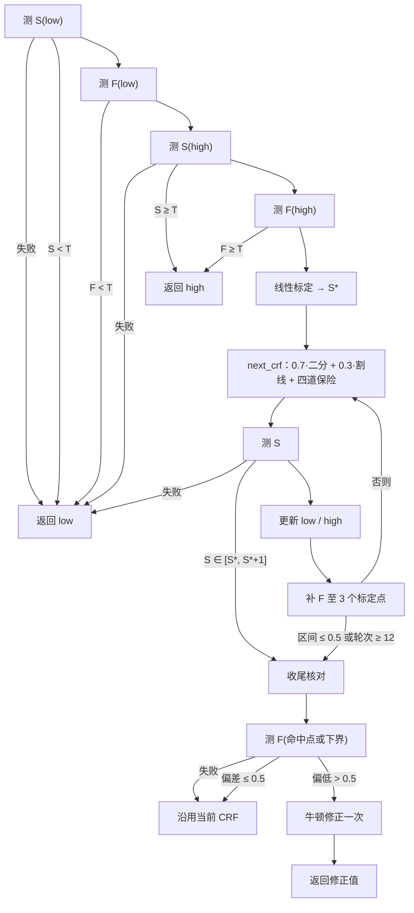

# media-box

按「感知质量」而不是码率压缩视频：给定目标 VMAF，在场景样本上搜索刚好达标的 CRF，再用它正式编码整片。编码器固定为 SVT-AV1（`libsvtav1`）。

- **按质量压，不按码率猜**：你给 VMAF 目标（默认 91），工具自己找对应的 CRF。
- **批量处理**：`-i` 可重复，目录按扩展名递归收集，逐个压缩、逐个汇报。
- **可随时中断**：`Ctrl+C` 一次取消当前阶段与正在运行的 ffmpeg，再按一次强制退出。
- **按内容调参**：自动识别场景、分析颗粒强度，避免全片一套参数。

## 快速开始

### 环境要求

- Rust 2024 edition（rustc ≥ 1.95：使用 `cfg_select!` 与 let-chains）
- `ffmpeg`、`ffprobe` 在 `PATH` 中
- ffmpeg 编译时启用 `--enable-libsvtav1` 与 `--enable-libvmaf`
- libvmaf ≥ 3.2（提供 `vmaf_v1.0.16_3d0h`、`vmaf_v1.0.16_1d5h_2160` 模型）

### 构建

```bash
cargo build --release
```

产物为 `target/release/media-box`。

### 第一条命令

```bash
media-box video-compress -i D:\videos\a.mkv
```

默认目标 VMAF 91、preset 4、输出到源视频所在目录。正式编码前的 CRF 搜索会对每个场景样本反复「编码 + 测 VMAF」，因此单片耗时明显高于单纯转码；4K 长片尤其明显。

## 使用

```bash
media-box video-compress -i <输入路径...> [选项]
```

`-i` 可重复指定，目录会按扩展名收集视频（不跟随符号链接，绝对的重复路径会去重）。

### 示例

```bash
# 单文件，输出到源视频所在目录
media-box video-compress -i D:\videos\a.mkv

# 批量目录，限制 1080p / 30fps，preset 6，目标 VMAF 93
media-box video-compress -i D:\videos -r 1920x1080 -f 30 -p 6 -v 93

# 递归两层，输出到指定目录
media-box video-compress -i D:\videos -d 2 -o D:\out
```

### 参数

| 参数 | 说明 | 默认 |
|---|---|---|
| `-i, --input <INPUT>` | 源视频文件或目录，可重复 | 必填 |
| `-r, --resolution <WxH>` | 输出最大分辨率（`x`/`X`/`×` 均可），超出则按 lanczos 缩放 | 跟随源 |
| `-o, --output <DIR>` | 输出目录，不存在会自动创建 | 源视频所在目录 |
| `-d, --depth <N>` | 目录递归深度，0 表示只处理该目录本身 | 0 |
| `-f, --fps <FPS>` | 输出帧率上限 | 跟随源 |
| `-p, --preset <0-13>` | SVT-AV1 preset，数值越大越快、体积越大 | 4 |
| `-v, --vmaf <SCORE>` | 目标 VMAF 分数（v1 体系，1-100） | 91 |

### 怎么调

| 想要 | 调整 |
|---|---|
| 更小的文件 | 降 `-v`（如 88~90），或升 `-p` |
| 更好的画质 | 升 `-v`（如 93~95） |
| 编码更快 | 降 `-p`（如 2~3），或加 `-r` 降分辨率 |
| 4K 太慢 | `-r 1920x1080`：搜索和正式编码都会明显变快 |

`-v` 差 1 分通常肉眼难辨，但体积可能差 5%~10%；建议先拿一小段素材试 91 与 93 再决定。

## 输出

- 文件名：`<源文件名>-<yymmddHHMMSS>.mp4`，时间戳为 UTC。
- 位置：`-o` 指定目录或源视频所在目录。
- 成功后在总结页打印源/输出体积、体积变化百分比、源时长与压缩耗时、完整 ffmpeg 命令。

## 中断与失败处理

- `Ctrl+C` 一次：取消当前阶段（含正在运行的 ffmpeg），结束整批；再按一次强制退出（退出码 1）。
- 结束页按「成功 / 失败 / 警告 / 已取消或未处理」分类汇总。
- 元数据读取失败：该文件计为失败，继续下一个。
- 场景检测失败：退化为固定位置采样，不阻塞编码。
- VMAF 测量失败：告警并沿用当前最优 CRF，继续正式编码。
- 正式编码失败或取消：删除半成品输出文件。

## 已知限制

- 只处理扩展名白名单内的视频（mp4/mkv/mov/avi/webm 等），不跟随符号链接。
- CRF 搜索对每个样本都做真实编码 + 测量，4K 长片耗时明显。
- 输出时间戳为 UTC，未引入本地时区依赖。
- 依赖 ffmpeg 的 `libvmaf` 模型名，libvmaf 版本过低会测量失败（仅告警并退回当前 CRF）。

## 测试

### 运行

```bash
cargo test                      # 全部
cargo test --test crf_search    # 只跑搜索策略的行为测试
cargo test --lib                # 只跑模块内单元测试
cargo clippy --all-targets      # 建议与测试一起跑
cargo fmt --check
```

测试**不需要 ffmpeg**：搜索逻辑用合成曲线驱动，解析逻辑用固定文本驱动。唯一会碰文件系统的是 `tests/media_scan.rs`，它在系统临时目录建一棵小树，测试结束自动删除。

### 原则

1. **断言用户能观察到的事实**：全规格 VMAF 是否达标、文件落在哪、`-d` 扫到哪些文件；不约束「第 3 轮用的是哪个 CRF」。
2. **改实现不该改测试**：换公式、调常数、换收敛路径时测试应保持绿。如果每次重构都要改测试，多半是测试写错了层次。
3. **一个契约一条测试**：同一契约的多个等价类合并进一条用例，用循环表达。
4. **崩溃回归单独留一条**：短视频、越界切点、取消——这些是真实踩过的 panic，值得独立用例。
5. **不测私有中间值**：私有类型的中间状态（标定系数、候选序列）由行为测试间接覆盖。

### 不测什么

- **真实 ffmpeg 编码 / VMAF 测量**：依赖外部二进制与特定素材，属于手动验收。
- **终端渲染快照**：字符画对终端尺寸敏感，维护成本高于收益。
- **精确搜索轨迹与轮次计数**：调参即红，是实现细节。

### 新增测试的检查清单

- [ ] 断言的是「用户看到的结果」，还是「某次调用的中间值」？
- [ ] 把算法换成另一种写法，这条测试会不会红？会 → 大概率测的是实现。
- [ ] 失败信息能直接看出用户受了什么影响吗？
- [ ] 能不能用一条参数化用例替代三条？

## 实现细节

> 以下内容面向改代码的人，普通使用不需要读。

### 流程

```
源视频
  └─ 元数据（ffprobe）
      └─ 场景采样（ffmpeg scdet）
          └─ film-grain 强度分析（signalstats / YDIF）
              └─ CRF 搜索（逐轮编码样本 + libvmaf 测量）
                  └─ 正式编码（optimal_crf + preset + film-grain）
```

终端界面按阶段展示：`✓` 已完成、转圈表示当前阶段、`·` 未开始，阶段内会附加说明（如「CRF 32.00 · 样本 2/3 · VMAF 测量」）；只有正式编码阶段显示百分比、已用时间与剩余时间。

### 场景采样

- `ffmpeg -vf scdet` 全片扫切点；相邻切点间隔 < 1s 视为同一簇，只保留分数最高者。
- 按切点切分场景，丢弃时长 < 2s、与片头/片尾 5% 重叠的场景。
- 取最长的至多 3 个场景，各取中点，单个样本最多 20s。
- 全片 ≤ 100s 时只取全片中点样本（最多 20s）。
- 检测失败、无切点或无可用场景：退化为 1/4、1/2、3/4 位置采样，各最多 20s。

### film-grain

- 每个样本取约 2s，用 `signalstats` 输出 YDIF，计算均值与变异系数 CV。
- 置信阈值动态计算：`clamp(0.5 + 0.2 × min(ydif / 15, 1), 0.5, 0.7)`。
- 高置信样本数 ≥ `max(1, ceil(K/2))` 时取这些样本的中位数，否则取全部有效样本的中位数。
- YDIF 代表值映射：< 1 → 0，1–3 → 4，3–8 → 8，8–15 → 12，> 15 → 15。
- 分析失败或样本全失效：`film-grain=8`。

### CRF 搜索

- 初始区间按输出分辨率：4K 24–55、2K 22–52、1080p 20–50、720p 18–45、更低 16–40。
- 先测 low / high 两个端点，每个端点都输出「同规格」与「全规格」两个 VMAF：
  - 同规格：参考视频下采样到输出规格，只衡量编码损失；
  - 全规格：失真视频上采样回源规格，包含降规格损失，用于对齐用户目标。
- 未改动分辨率与帧率时两者是同一次测量：跳过端点全规格、标定与收尾复核，直接单口径搜索（测量次数约减 40%）。
- 端点直接判定：low 的全规格分仍不达标 → 返回 low；high 的全规格分已达标 → 返回 high。
- 用两点线性拟合把全规格目标换算为同规格搜索目标 `S*`；凑满第 3 个标定点后尝试一次三点二次拟合（端点测量失败会自动补测；带单调性、曲率校验，校验失败退回线性）。
- 搜索采用二分 + 斜率插值混合（插值瞄准 `S*`），同 CRF 去重后强制退回二分中点。
- 收敛条件：区间 ≤ 0.5，或同规格分数落在 [`S*`, `S*` + 1]，或达到 12 轮。
- 收敛后返回**命中点**（未命中则返回下界），再用全规格 VMAF 复核：偏差 ≤ 0.5 直接采用；偏低时按斜率微调一次 CRF。

### CRF 搜索的数学

> 代码：`src/crf_search.rs`。本节解释「为什么这样搜」，以及每个常数背后的取舍。

#### 1. 问题与两个口径

记 `S(c)` 为同规格 VMAF、`F(c)` 为全规格 VMAF，两者都随 CRF 单调递减。
要求 `c*` 使 `F(c*) = T`（`T` 为用户目标）。没有解析解，只能实测。

为什么迭代用 `S`、收尾才用 `F`：

| 口径 | 参考帧 | 失真帧 | 计算量 | 抖动 |
|---|---|---|---|---|
| `S` 同规格 | 缩到输出分辨率 | 原样 | 小 | 小 |
| `F` 全规格 | 原样 | 上采样回源分辨率 | 大（按源分辨率算） | 大 |

每轮都测 `F`，成本翻倍且更噪；只信 `S` 又会系统性偏（`F ≈ S - δ`）。
折中方案：**用 `S` 驱动搜索，用标定点把目标搬到 `S` 轴，最后用 `F` 核对一次**。

```text
VMAF
 92 ┤ L●●
 88 ┤ ┈┈┈●●★●●┈┈┈┈┈┈┈┈┈┈┈┈┈┈┈┈┈┈┈┈┈┈┈
 84 ┤         ●●●●●
 80 ┤              ●●●●●
 76 ┤                   ●●●●●
 72 ┤                        ●●●●●
 68 ┤                             ●●H
```

横轴 CRF 20 → 50，纵轴每行 4 分；`L` = 下界 20，`H` = 上界 50，`★` = 目标 88，
`┈` = 目标容差带 [88, 89]，`●` = `S(c)`。

#### 2. 单调性 → 二分

`S` 单调递减，所以区间始终可以这样维护：

```text
初始            第 1 轮                 第 2 轮
20 ─── 50       20 ─── 35 ─── 50        20 ─ 27.5 ─ 35 ─ 50
                    ↑                       ↑
                 S(35)=80 < S*           S(27.5)=90 ≥ S*
                 high ← 35               low ← 27.5
```

不变式：`S(low) ≥ S*` 且 `S(high) < S*`。每轮取中点即可把区间减半，
`log2(30 / 0.5) ≈ 6` 轮就够。但二分完全不利用曲线形状，起点远时收敛慢。

#### 3. 割线法：用最近两点估斜率

把最近两次测量 `(c₁, S₁)`、`(c₂, S₂)` 连成直线，外推到目标：

```text
k        = (S₂ - S₁) / (c₂ - c₁)      ← 单位「分 / CRF」，负数
c_interp = c₂ + (S* - S₂) / k
```

例：`(20, 92)`、`(50, 68)`，`S* = 89` → `k = -0.8` → `c_interp = 50 + 21/(-0.8) = 23.75`，
一步就跳到答案附近。

单独用很危险：

- 平台区（`|k| < 0.1`）→ 分母趋零，外推飞出天际；
- 断崖区（`|k| > 10`）→ 一点噪声就差好几档；
- 任一点测错，下一步直接出区间。

因此只信任 `k ∈ (-10, -0.1)`（`trusted_slope`）。

#### 4. 混合 + 四道保险

```text
c_bisect = (low + high) / 2
c_mixed  = 0.7 · c_bisect + 0.3 · c_interp     ← 保守为主，插值为辅
c_next   = clamp(c_mixed, low, high)            ← 保险 1：不出区间
         = clamp(·, c_prev ± max_step)          ← 保险 2：单轮步长
         → 吸附 0.25 网格                        ← 保险 3：与 CRF 类型一致
         → 与 c_prev 相同或越界则退回 c_bisect    ← 保险 4：保证有进展

max_step = clamp((high - low) / 2, 0.5, 8.0)
```

权重偏二分，是因为样本 VMAF 有 ±0.5~1 的噪声，割线对噪声敏感而二分永远安全。
步长上限防的是「斜率估偏 → 跳到边缘 → 下一轮跳回来」的震荡。

#### 5. 标定：把目标从 `F` 轴搬到 `S` 轴

只用 `S = T` 去搜会停在画质偏高的一侧：`F = S - δ`（`δ > 0`），所以 `S = T` 时
`F = T - δ < T`，还得继续压 CRF。标定就是估出这条偏移，解 `S*` 使 `F(S*) = T`。

**线性（两个端点）**

```text
a  = (F₂ - F₁) / (S₂ - S₁)
b  = F₁ - a·S₁
S* = (T - b) / a          ← 再夹到 [min(S₁,S₂), max(S₁,S₂)]
```

例：端点 `(92, 91)`、`(68, 67)` → `a = 1`、`b = -1` → `T = 88` 时 `S* = 89`。
含义：同规格测到 89 分时，全规格大约就是 88 分。夹取是因为两点之外属于外推。

**二次（三个点，凑满后尝试一次）**

`F(S) = a·S² + b·S + c`，解 `a·S² + b·S + (c - T) = 0`：

```text
Δ = b² - 4a(c - T)
S = (-b ± √Δ) / (2a)      ← 取落在 [S₁, S₃] 内的那个根
```

用二次是因为低码率一侧降规格损失占比变化更快，`F - S` 不是常数。

标定点来自全规格测量：两个端点各一个，第 3 个在搜索轮次里补测。
补测条件是「不足 3 个点」，所以某个端点的测量失败时会自动在后续轮次补齐；
正常路径（两端点都成功）只多花一次全规格测量。凑满 3 点后只尝试一次，
校验不过就永久退回线性，不会每轮重复测。

三道安全校验，任何一条不满足就退回线性（或直接用 `T`）：

| 校验 | 条件 | 不通过的含义 |
|---|---|---|
| 曲率 | `\|a\| ≤ 0.05` | 三点几乎共线，或全是噪声 |
| 单调 | 顶点落在区间外 | 区间内先降后升，反解有两个根 |
| 有解 | `Δ ≥ 0` | 目标值没被这条抛物线取到 |

#### 6. 收敛与终止

| 条件 | 判据 | 说明 |
|---|---|---|
| 命中窗口 | `S ∈ [S*, S*+1]` | 窗口跟着标定后的目标走，只向上放宽 |
| 区间收敛 | `high - low ≤ 0.5` | 网格 0.25，再分没有意义 |
| 轮次上限 | `round ≥ 12` | 病态曲线兜底（正常 5~7 轮） |

命中窗口时**返回命中点**（`hit_crf`）；只有区间收敛/轮次上限才退回下界 `low`。
窗口围绕 `S*` 而不是 `T`：只围 `T` 时，命中点按标定其实还不达标，收尾会被迫做一次大修正。
代价是命中点没有下界不变式背书，达标完全由下一节的收尾核对兜底。

#### 7. 收尾：全规格核对 + 一次牛顿修正

```text
delta = F(c_hit) - T

|delta| ≤ 0.5          → 直接采用 c_hit
delta < -0.5（偏低）    → 局部线性化 F(c+Δ) ≈ F(c) + k·Δ，k = dF/dc < 0
                          Δ  = -delta / k
                          c' = c + 0.8·Δ      ← 0.8 阻尼防过冲
```

符号要小心：`delta < 0`、`k < 0` ⇒ `Δ < 0` ⇒ `c' < c`（降 CRF、提画质）。
写成 `c + delta·(dc/dF)` 会得到 `c' > c`，越修越差——这是修掉的一个符号错误。

数值例：`c = 20`、全规格 86、目标 88 → `delta = -2`、`dc/dF = -1.25`
→ `Δ = -2.5` → `c' = 20 - 2.0 = 18`，夹到 `[low-1, high]` 得 19；
`F(19) = 86.8`，误差从 2.0 收到 1.2。

#### 8. 一个完整的例子

合成曲线 `S(c) = 100 - 0.8(c-10)`、`F = S - 1`，目标 88：

| 轮次 | 动作 | CRF | S | 区间 | 说明 |
|---|---|---|---|---|---|
| 1 | 测下界 | 20.0 | 92.0 | [20, 50] | 达标；全规格 91 → 标定点 (92, 91) |
| 2 | 测上界 | 50.0 | 68.0 | [20, 50] | 未达标；标定点 (68, 67) |
| — | 线性标定 | — | — | — | `F = S - 1` → `S* = 89` |
| 3 | 候选 | 42.0 | 74.4 | [20, 42] | interp=23.75、mid=35、mixed=31.6，步长上限 8 → 42 |
| 4 | 候选 | 34.0 | 80.8 | [20, 34] | mixed=28.8，步长 8 → 34 |
| 5 | 候选 | 27.0 | 86.4 | [20, 27] | mixed=26.0，步长 7 → 27 |
| 6 | 候选 | 23.5 | 89.2 | [20, 27] | 落入 [89, 90]，命中 |
| 收尾 | 全规格 | 23.5 | — | — | `F = 88.2`，偏差 +0.2，直接采用 |

共 10 次测量：2 端点 × 2 口径 + 4 轮 `S` + 1 次补测 `F` + 1 次收尾 `F`。
第 3~4 轮仍受步长上限 8 约束（插值早就指向 23.75），第 5 轮起上限降到 7，不再是瓶颈。

#### 9. 流程



#### 10. 常数与成本

| 常数 | 值 | 作用 | 调大的后果 |
|---|---|---|---|
| `MAX_SEARCH_ROUNDS` | 12 | 轮次上限 | 病态曲线更慢 |
| `TARGET_SCORE_TOLERANCE` | 1.0 | 命中窗口宽度 | 更早收敛，体积更大 |
| `FINAL_CHECK_TOLERANCE` | 0.5 | 收尾容差 | 更容易跳过修正 |
| `MIN_SEARCH_SPAN` | 0.5 | 区间收敛阈值 | 更多轮 |
| 混合权重 | 0.7 / 0.3 | 二分 : 割线 | 更激进（快但抖） |
| 单轮步长 | 0.5 ~ 8.0 | 防震荡 | 更激进 |
| 阻尼 | 0.8 | 牛顿修正 | 更容易过冲 |

单次搜索成本 ≈ `(2 + 2 + R + 2) × 样本数` 次编码 + 同数量 VMAF 测量，`R` 为搜索轮次。
3 样本、6 轮 ≈ 36 次编码——这是「CRF 搜索比正式编码还贵」的原因。

#### 11. 已知取舍

- 命中窗口返回命中点，体积更小；代价是「达标」只由收尾核对兜底，命中点本身没有下界不变式背书。
- 二次标定凑满 3 点后只尝试一次，校验不过就退回线性；退化路径（端点测量失败）会自动补测，
  最坏多花 2 次全规格测量。
- 步长上限 8 在起点远离答案时仍可能多走 1~2 轮（第 8 节的第 3~4 轮），换来的是抗噪。

### 编码参数

`libsvtav1`，`-preset <p>`，`-crf <crf>`，`-flags -cgop`，`yuv420p10le`，`-svtav1-params tune=5:keyint=-1:qp-scale-compress-strength=1:film-grain=<fg>`；音频 `-c:a copy`；缩放与限帧通过 `scale=...:flags=lanczos` 和 `fps=` 滤镜完成。

## 参考文档

- <https://gitlab.com/AOMediaCodec/SVT-AV1/-/blob/master/Docs>
- <https://handbrake.fr/docs/en/1.11.0/>
- <https://ffmpeg.org/documentation.html>

## 许可证

MIT。
